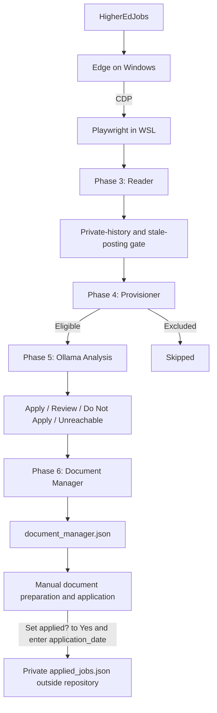
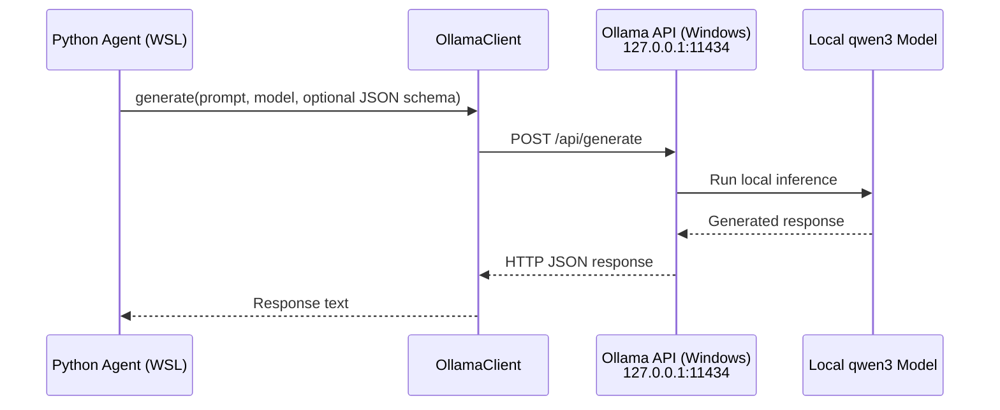
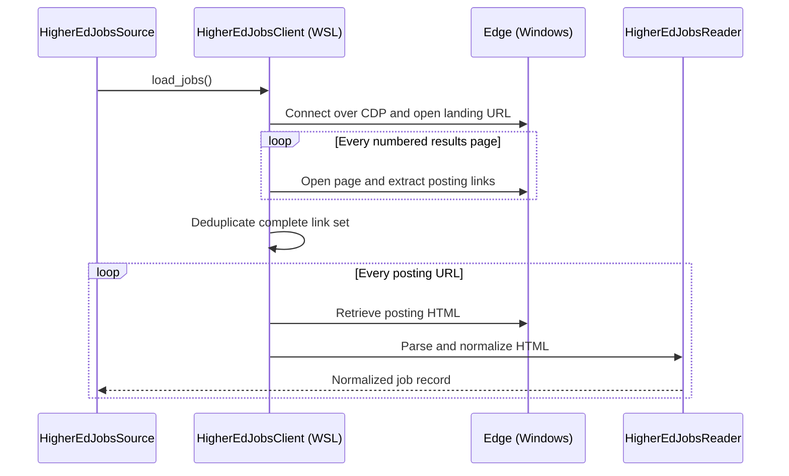
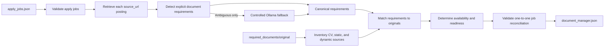
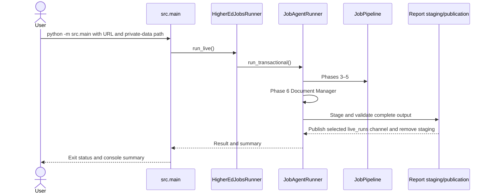
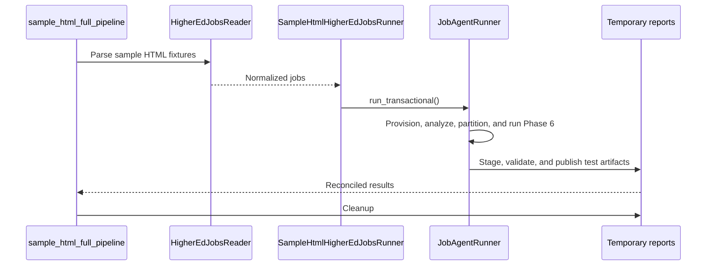

# AI Job Agent

# 1. Overview

AI Job Agent is a local-first assistant for discovering, filtering, and
analyzing academic jobs and identifying their required application materials.
Python runs in WSL, while Microsoft Edge and Ollama run natively on Windows.
HigherEdJobs is the current job source, and a local Ollama model performs job
analysis and controlled document-requirement fallback.

The automated scope ends with the generated JSON and text reports. The user
reviews those reports, prepares or updates application documents, submits
applications, and tracks outcomes manually. Job-Agent does not generate or
tailor application documents, submit applications, or learn from application
feedback. The user supplies one external private-data directory containing
`user_profile.toml`, `applied_jobs.json`, and `closed_jobs.json`; no personal
preferences or filesystem path are stored in the repository.


# 2. System Architecture

The current implementation uses Microsoft Edge with a Chrome DevTools
Protocol (CDP) endpoint. Other Chromium-based browsers may be compatible, but
Edge is the tested reference.



## 2.1 Job Outcomes
Every discovered job ends in exactly one report category: `apply`, `review`,
`do_not_apply`, `skipped`, or `unreachable`. Section 6 describes the report
files. Remote and non-remote alerts have independent report channels. Every
job record includes `"remote?": "Yes"` or `"No"`, derived deterministically
from HigherEdJobs structured metadata and posting text.

# 3. Prerequisites

| Requirement | Role |
|---|---|
| Windows 11 | Hosts Microsoft Edge and Ollama. |
| WSL2 Ubuntu with mirrored networking | Runs Python, Playwright, agents, pipeline, and report generation. |
| Python 3.14+ and `python3-venv` | Application runtime and virtual environment. |
| Microsoft Edge or compatible Chromium browser | Exposes CDP; Edge is the tested reference. |
| Ollama with `qwen3:8b` | Handles job analysis and controlled document-requirement fallback. |
| Git and GitHub access | Source control. |
| VS Code with WSL, Python, and Pylance extensions | Recommended development environment. Codex and GitHub extensions are optional. |

# 4. Installation

Clone the repository and create the virtual environment:

```bash
git clone git@github.com:amalmuraeb/ai.git
cd ai
```

```bash
python3 -m venv .venv
source .venv/bin/activate
```

Install Python dependencies and Playwright browser support:

```bash
pip install -r dependencies.txt
python -m playwright install chromium
```

Install the local model on Windows, verify it, and start Ollama:

```powershell
ollama pull qwen3:8b
ollama list
ollama serve
```

WSL accesses Ollama through mirrored-networking localhost at
`http://127.0.0.1:11434`.

# 5. Pipeline Phases

## Phase 1 — Environment Setup

```text
Purpose      | Establish the local development environment and supporting tools
-------------------------------------------------------------------------------
Input        | Development machine
-------------------------------------------------------------------------------
Output       | Ready-to-use local development environment
-------------------------------------------------------------------------------
Dependencies | None
```
Under Windows, create `%USERPROFILE%\.wslconfig`:

```ini
[wsl2]
networkingMode=mirrored
```

Apply it from PowerShell, then restart WSL:

```powershell
wsl --shutdown
```

Mirrored networking exposes Windows-hosted services to WSL through
`127.0.0.1`. Launch Edge with the dedicated profile and HigherEdJobs landing
URL using these commands or the equivalent `scripts/start_job_agent_edge.ps1`
script copied to Windows:

```powershell
$LandingUrl = "https://www.higheredjobs.com/myHigherEdJobs/Agent/viewagent.cfm?AgentID=123456"

Get-Process msedge -ErrorAction SilentlyContinue | Stop-Process -Force

& "C:\Program Files (x86)\Microsoft\Edge\Application\msedge.exe" `
    --remote-debugging-port=9222 `
    --user-data-dir="C:\JobAgent\HigherEdJobsProfile" `
    --new-window `
    $LandingUrl
```

The `AgentID=123456` value is a generic example. Copy the complete saved-alert
results URL from your signed-in HigherEdJobs browser. To use the script:

```powershell
.\start_job_agent_edge.ps1 -LandingUrl $LandingUrl
```

Verify CDP from Windows:

```powershell
Invoke-RestMethod http://127.0.0.1:9222/json/version
```

Then verify it from WSL:

```bash
curl http://127.0.0.1:9222/json/version
```

Both responses must include `Browser`, `Protocol-Version`, and
`webSocketDebuggerUrl`.

## Phase 2 — Core Infrastructure

```text
Purpose      | Provide the reusable AI infrastructure shared by all project components
--------------------------------------------------------------------------------------
Input        | User profile, Ollama server, Python requests
--------------------------------------------------------------------------------------
Output       | AI services and common utilities
--------------------------------------------------------------------------------------
Dependencies | Phase 1
```
Phase 2 provides the shared Python-to-Ollama interface, agent foundation,
profile configuration, JSON parsing, tests, and source control used by later
phases.

### Components

| Component | Location | Responsibility |
|---|---|---|
| Ollama configuration | `src/config/ollama.py` | Configures `http://127.0.0.1:11434`, `qwen3:8b`, non-streaming generation, disabled thinking output, and request timeouts. |
| Ollama client | `src/ollama_client.py` | Sends prompts and optional JSON schemas to Ollama's `/api/generate` endpoint and returns the model response. |
| Agent base | `src/agent.py` | Selects the model, combines provisioned job data with the injected private profile, builds the structured-analysis prompt, and invokes the Ollama client. |
| Profile loader | `src/profile_loader.py` | Loads and validates external `user_profile.toml`; no personal preferences are stored in the repository. |
| JSON utilities | `src/json_utils.py` | Converts JSON model responses into Python dictionaries for downstream processing. |
| Tests | `src/test/` | Contains deterministic regression tests and explicit external-integration tests; see Section 7. |
| Git repository | `git@github.com:amalmuraeb/ai.git` | Tracks source history and project milestones. |

### Ollama Connection

Ollama runs natively on Windows and is configured to listen on
`0.0.0.0:11434`. With WSL mirrored networking enabled, Job-Agent connects to
the Windows service through `http://127.0.0.1:11434`. The configured default
model is `qwen3:8b`.



Verify the Windows-hosted service from WSL:

```bash
curl http://127.0.0.1:11434/api/tags
```

### Structured Analysis Contract

The base agent injects the validated private profile into its prompt and asks Ollama for
machine-readable job analysis. `parse_json_response()` converts that response
into a Python dictionary consumed by later phases. Representative fields are:

```json
{
  "fit_score": 95,
  "focus_areas": [],
  "must_have_skills": [],
  "missing_skills": [],
  "risk_flags": []
}
```

## Phase 3 — Job Source Reader

```text
Purpose      | Convert raw job postings into structured job data
----------------------------------------------------------------
Input        | Raw job posting text
----------------------------------------------------------------
Output       | Structured job information
----------------------------------------------------------------
Dependencies | Phase 2
```

`HigherEdJobsReader` inherits from `JobSourceReader` and normalizes each
posting using Schema.org `JobPosting` data when available, with visible HTML
as the fallback.

### Phase 3.1 HigherEdJobs Runtime Architecture
Edge preserves authentication and displays login or CAPTCHA pages when manual
action is required. Playwright connects from WSL over CDP. Because only the
current results page exists in the DOM, the client traverses numbered pages,
deduplicates all posting URLs, and then retrieves each posting.



## Phase 4 — Job Provisioner

```text
Purpose      | Apply deterministic filtering and preprocessing before LLM analysis
----------------------------------------------------------------------------------
Input        | Structured job data
----------------------------------------------------------------------------------
Output       | Provisioned job or structured skip record
----------------------------------------------------------------------------------
Dependencies | Phase 2, Phase 3
```
The provisioner applies the externally loaded `user_profile.toml` criteria
before LLM analysis. Public rule catalogs define reusable matching behavior;
only the private profile identifies which rules and thresholds the user has
selected. Rejected jobs become structured skip records and never invoke
Ollama. Eligible jobs retain normalized data, `source_url`, the employer
application-system `apply_url` extracted from the posting, warnings, and
provisioning results. Missing salary remains eligible for LLM review.

Before Phase 4, a posting-age gate avoids processing likely stale listings:

| Posting age | Closing date | Result |
|---|---|---|
| Up to one year | Missing, or outside the configured closing-soon window | Keep |
| Over one year and under two years | Outside the configured closing-soon window | Keep |
| Over one year and under two years | Missing, unparseable, or inside the closing-soon window | Discard |
| Two years or older | Any | Discard |

Jobs without a parseable posting date remain eligible. Stale jobs are removed
before provisioning, receive no recommendation, and appear in no job-level
report. `summary.json` records only their aggregate count as
`discarded_stale_jobs`.

## Phase 5 — Job Analysis Agent

```text
Purpose      | Evaluate provisioned jobs using the local LLM and user profile
-----------------------------------------------------------------------------
Input        | Provisioned job data
-----------------------------------------------------------------------------
Output       | Structured job evaluation (JSON)
-----------------------------------------------------------------------------
Dependencies | Phase 2, Phase 4.
```
The analysis agent evaluates only provisioned jobs against the private profile and
returns the structured schema defined in `src/agent.py`. It extracts
posting-supported `focus_areas` and `must_have_skills` for reporting. The
pipeline merges the response with preserved source and provisioning metadata,
then assigns the final report category.

## Phase 6 — Document Manager

```text
Purpose      | Manage and validate required application documents
-----------------------------------------------------------------
Input        | Phase 5 apply report, posting bodies, and document folders
-----------------------------------------------------------------
Output       | document_manager.json readiness report
-----------------------------------------------------------------
Dependencies | Phase 2, Phase 5
```
The Document Manager converts every Phase 5 `apply` job into an application-
readiness plan. Job-Agent does not generate or tailor application documents.



The report preserves exact posting evidence, selected templates, missing
materials, `manual_review_required`, readiness, permanent
`job_sequence_number` values, and user-maintained `applied?` and
`application_date` fields. Ambiguous or unsupported requirements remain
flagged for manual review.

Phase 6 updates rather than recreates the application plan. Active unapplied
jobs keep their existing records and sequence numbers, new jobs receive the
next never-reused number, and expired unapplied jobs are removed. Records
manually marked `"applied?": "Yes"`, with `application_date` entered by the
user, move to the permanent private `applied_jobs.json` archive outside the
repository. A later discovery of an archived job is suppressed and is not
assigned another number.

Supported types include CV, cover letter, personal statement,
research statement, teaching statement, service statement, references,
transcripts, and representative publications. Private originals remain under
the Git-ignored `required_documents/original/` directory. The report is
published to `output/job_boards/higheredjobs/reports/live_runs/document_manager.json`.

# 6. Repository Structure

```text
job-agent/
├── src/
│   ├── config/
│   │   ├── documents.py
│   │   │   Private original-material inventory path
│   │   ├── report_paths.py
│   │   │   Configured production and staging report paths
│   │   └── (other configuration modules)
│   │       Application-level rules, heuristics, connection settings,
│   │       and parsing patterns
│   │
│   ├── main.py
│   │   Production command entry point and final console summary
│   │
│   ├── job_agent_runner.py
│   │   Parent runner containing shared pipeline orchestration,
│   │   validation, report generation, staging, and publication
│   │
│   ├── agent.py
│   ├── profile_loader.py
│   ├── json_utils.py
│   ├── ollama_client.py
│   ├── document_manager.py
│   ├── job_analysis_agent.py
│   ├── job_source_reader.py
│   ├── job_pipeline.py
│   ├── job_results_manager.py
│   ├── job_provisioner.py
│   │
│   ├── job_boards/
│   │   └── higheredjobs/
│   │       ├── client.py
│   │       │   Browser connection and HigherEdJobs page retrieval
│   │       ├── reader.py
│   │       │   HigherEdJobs-specific parsing and normalization
│   │       ├── source.py
│   │       │   Coordinates live acquisition and parsing
│   │       ├── document_source.py
│   │       │   Retrieves current apply-job postings for Phase 6
│   │       └── runner.py
│   │           HigherEdJobsRunner implementation of JobAgentRunner
│   │
│   └── test/
│       ├── regression.py
│       │   Single entry point for the deterministic regression suite
│       │
│       ├── job_boards/
│       │   └── higheredjobs/
│       │       ├── sample_html_full_pipeline.py
│       │       │   Offline E2E regression using sample HTML fixtures
│       │       └── (live integration tests)
│       │           HigherEdJobs CDP, retrieval, parsing, provisioning,
│       │           and live pipeline tests
│       ├── data/
│       │   └── job_provisioner_cases.py
│       ├── document_manager.py
│       │   Deterministic Phase 6 inventory and readiness-plan test
│       └── (other tests)
│           Component, behavioral, integration, and pipeline tests
│
├── input/
│   └── job_boards/
│       └── higheredjobs/
│           Sample HTML job postings
│
├── output/
│   └── job_boards/
│       └── higheredjobs/
│           └── reports/
│               ├── .non-remote_live_staging/
│               ├── .remote_live_staging/
│               │   Scope-specific temporary production output;
│               │   removed after publication or failure
│               │
│               ├── example_reports/
│               │   Tracked sample reports published for reference
│               │
│               └── live_runs/
│                   Local production output excluded from Git
│                   ├── non_remote/
│                   │   └── Same report structure shown below
│                   └── remote/
│                       ├── analyzed/
│                       │   ├── apply_jobs.json (1)
│                       │   ├── apply_jobs_stats.txt (2)
│                       │   ├── review_jobs.json (3)
│                       │   └── do_not_apply_jobs.json (4)
│                       ├── skipped_jobs.json (5)
│                       ├── unreachable_jobs.json (6)
│                       ├── document_manager.json (7)
│                       ├── log.txt (8)
│                       └── summary.json (9)
│
├── required_documents/
│   Private local folder for application materials;
│   intentionally excluded from GitHub
│   └── original/
│   │   ├── cv/
│   │   │   CV originals
│   │   ├── static/
│   │   │   Reusable non-tailored documents such as references
│   │   │   and evaluations
│   │   └── dynamic/
│   │       Dynamic document originals inventoried by Document Manager
│
├── private_data/  (user-selected location outside repository)
│   ├── user_profile.toml
│   │   Private job-search preferences and thresholds
│   ├── applied_jobs.json
│   │   Private, permanent personal application history supplied by CLI
│   └── closed_jobs.json
│       Private, manually maintained closed-posting list supplied by CLI
│
├── .gitignore
│   Excludes private documents, virtual-environment files,
│   cache files, generated reports, and Windows metadata files
│
├── dependencies.txt
│   Python runtime dependencies
│
├── user_profile.example.toml
│   Fictional public template for the external private profile
│
└── README.md
```

| No. | Report | Contents |
|---|---|---|
| 1 | `apply_jobs.json` | Active unapplied jobs recommended for application, with permanent sequence numbers and application URLs. |
| 2 | `apply_jobs_stats.txt` | Human-readable state-to-job-sequence-number table derived from `apply_jobs.json`. |
| 3 | `review_jobs.json` | Successfully analyzed jobs requiring a human decision, including application URLs. |
| 4 | `do_not_apply_jobs.json` | Successfully analyzed jobs not recommended for application. |
| 5 | `skipped_jobs.json` | Deterministically filtered jobs, including duplicates and excluded salary, employment type, discipline, industry, role, or focus. These are not pipeline failures. |
| 6 | `unreachable_jobs.json` | Operational failures such as CAPTCHA, retrieval, parsing, timeout, malformed content, or LLM failure. |
| 7 | `document_manager.json` | Phase 6 instructions, selected originals, missing materials, manual-review state, and readiness. |
| 8 | `log.txt` | Current invocation only: mode, failures or interruption, completion status, and pipeline details where applicable. It is cleared when `src.main` starts. |
| 9 | `summary.json` | Outcome counts, paths, validation, and human-readable timing such as `2 m 5.2 s` or `1 h 32 m 48.48 s`. |

`example_reports/` contains the repository's fixed sample report set.
Production reports, including `apply_jobs_stats.txt`, are generated under
`live_runs/non_remote/` or `live_runs/remote/` and excluded by `.gitignore`;
do not force-add or publish them. Each run replaces only its selected channel,
so remote and non-remote alerts may be run in either order.
Transactional staging artifacts are ignored as well.

Non-remote apply jobs use permanent integer sequence numbers (`1`, `2`, ...).
Remote apply jobs use an independent permanent sequence prefixed with `r`
(`r1`, `r2`, ...). Both sequences share the external private history without
sharing counters. Each report's metadata identifies its `job_scope` as
`non_remote` or `remote`.

The permanent compact `applied_jobs.json` archive contains applied-job
identity, tracking fields, `focus_areas`, and `must_have_skills`. The private
`closed_jobs.json` list identifies postings the user has manually confirmed
are closed. Every production command requires the absolute external directory
through `--private_data_path`; Job-Agent reads the profile and both history
files from that directory. `--done_jobs_path` remains a compatibility alias.
Windows paths are normalized to their WSL `/mnt/<drive>/...` equivalents, and
the private path is redacted from `log.txt`. Applied and manually closed URLs
are removed before Phase 4, receive no recommendation, and appear in no
repository JSON report.


# 7. Running Job-Agent

## 7.1 Agent

Run commands from the repository root with the virtual environment activated.
Shared report destinations come from `src/config/report_paths.py`. The private
profile/history directory and HigherEdJobs alert URL are supplied through the CLI.

| Scope | Command | Requires | Primary effect |
|---|---|---|---|
| Non-remote Phases 3–6 | `python -m src.main --landing_url <NON_REMOTE_ALERT_URL> --private_data_path <PRIVATE_DATA_PATH>` | Edge/CDP and Ollama | Replace only `live_runs/non_remote/`. |
| Remote Phases 3–6 | `python -m src.main --remote --landing_url <REMOTE_ALERT_URL> --private_data_path <PRIVATE_DATA_PATH>` | Edge/CDP and Ollama | Replace only `live_runs/remote/`. |
| Phases 3–5 | Add `--rpa` to either command | Edge/CDP and Ollama | Refresh only the selected channel through Phase 5. |
| Phase 6 | Add `--document_manager`; add `--remote` for the remote channel | Edge/CDP; Ollama only for ambiguity | Refresh Phase 6 only in the selected channel. |

For example, either of these path styles is accepted when Python runs in WSL:

```text
D:\private\job-agent\private_data
/mnt/d/private/job-agent/private_data
```

`<HIGHEREDJOBS_ALERT_URL>` is the complete saved-alert results URL copied from
HigherEdJobs. For example:

```text
https://www.higheredjobs.com/myHigherEdJobs/Agent/viewagent.cfm?AgentID=123456
```

The complete production call sequence is:



`HigherEdJobsRunner` specializes the common `JobAgentRunner` workflow. Reports
are staged under `output/job_boards/higheredjobs/reports/` and published to
the selected `live_runs/non_remote/` or `live_runs/remote/` channel only after
validation; failures preserve that channel's previous successful reports.

Complete run:

```bash
python -m src.main \
  --landing_url <HIGHEREDJOBS_ALERT_URL> \
  --private_data_path <PRIVATE_DATA_PATH>
```

Remote complete run:

```bash
python -m src.main --remote \
  --landing_url <REMOTE_ALERT_URL> \
  --private_data_path <PRIVATE_DATA_PATH>
```

### 7.1.1 Phases 3–5 — RPA

```bash
python -m src.main --rpa \
  --landing_url <HIGHEREDJOBS_ALERT_URL> \
  --private_data_path <PRIVATE_DATA_PATH>
```

RPA means Reader, Provisioner, and Analysis. It uses
`HigherEdJobsRunner.run_live_rpa()` and
`JobAgentRunner.run_rpa_transactional()` to refresh the five category reports,
`summary.json`, and `log.txt` through scope-specific RPA staging. It performs application-
history maintenance by archiving manually applied records, removing expired
unapplied records, and preserving active sequence numbers. It does not analyze
application-material requirements for newly discovered jobs; run Phase 6
afterward when the apply-job set changes.

### 7.1.2 Phase 6 — Document Manager only

```bash
python -m src.main --document_manager \
  --private_data_path <PRIVATE_DATA_PATH>
```

Add `--remote` to consume and update the remote channel instead:

```bash
python -m src.main --document_manager --remote \
  --private_data_path <PRIVATE_DATA_PATH>
```

This mode consumes the published `apply_jobs.json`, reconciles it with the
existing Document Manager and permanent applied-job archive, retrieves only
new current postings through Edge/CDP, and runs the Phase 6 workflow shown in
Section 5.
It does not reload results pages or rerun Phases 3–5. Ollama is invoked only
for ambiguous instructions.

Publication uses temporary files and rollback protection. Failure preserves
the previous reports; success updates `apply_jobs.json`, its derived
`apply_jobs_stats.txt`, `document_manager.json`, `applied_jobs.json`, and only
the Phase 6 and adjusted-total timing, timestamp, and Phase 6 validation in
`summary.json`.
Other upstream reports remain unchanged; `log.txt` is cleared at startup and
records the isolated Phase 6 invocation and its outcome.

## 7.2 Deterministic Regression Suite

Run the deterministic regression suite after each code change:

```bash
python -m src.test.regression
```

This is the routine test entry point. It runs each registered module in a
separate process and returns nonzero if any module fails. The registry in
`src/test/regression.py` is authoritative.

The E2E regression uses all HigherEdJobs fixtures under `input/`, a sample-file
source, and a deterministic analysis agent while retaining the production
runner workflow:



All outputs are temporary. The suite requires no Edge, HigherEdJobs, Ollama,
or network access.

## 7.3 External Integration Tests

Tests that require Edge/CDP, live HigherEdJobs data, or Ollama are intentionally
excluded from routine regression and must be run explicitly. For a smaller
live Edge-and-Ollama pipeline check:

```bash
python -m src.test.job_boards.higheredjobs.live_pipeline \
  --landing_url <HIGHEREDJOBS_ALERT_URL> \
  --private_data_path <PRIVATE_DATA_PATH>
```

# 8. Operating Checklists

## 8.1 First-Time Setup

Complete these user-specific settings once before the first run:

1. Configure WSL mirrored networking, create `.venv`, and install
   `dependencies.txt` as described in Sections 3–4.
2. Create the dedicated Job-Agent Edge profile, sign in to HigherEdJobs, and
   create separate saved alerts for non-remote and remote jobs. Copy both
   complete results URLs. Either alert may be processed first; supply
   `--remote` whenever the remote alert is processed.
3. Create a private-data directory outside this Git repository. Copy
   `user_profile.example.toml` into it as `user_profile.toml`, then replace
   the fictional values with your preferences. Supply this directory through
   `--private_data_path` on every Job-Agent run. Job-Agent creates and
   maintains `applied_jobs.json` in the same directory.

   Windows example:

   ```text
   D:\private\job-agent\private_data
   ```

   Equivalent WSL example:

   ```text
   /mnt/d/private/job-agent/private_data
   ```

4. Create `closed_jobs.json` inside `private_data`. Use the same report shape as
   `applied_jobs.json`; Job-Agent reads each job's `source_url` and never
   publishes closed jobs in repository reports.

   Minimal file content:

   ```json
   {
     "jobs": [
       {
         "job": {
           "source_url": "https://www.higheredjobs.com/details.cfm?JobCode=123456789"
         }
       }
     ]
   }
   ```

   ```text
   D:\private\job-agent\private_data\closed_jobs.json
   ```

5. Start Ollama and Edge, then verify the CDP connection from WSL as described
   in Section 5.

## 8.2 Running Job-Agent

1. Start Ollama and launch Edge with `start_job_agent_edge.ps1`, supplying
   either HigherEdJobs alert URL through `-LandingUrl`.
2. Run the non-remote alert without `--remote`; it replaces only
   `live_runs/non_remote/`.
3. Run the remote alert with `--remote`; it replaces only
   `live_runs/remote/`. The alert order is optional.
4. Review both report channels and their Document Manager plans.
5. Prepare the required documents and apply manually outside Job-Agent.
6. In `document_manager.json`, set `"applied?": "Yes"` and enter the
   `application_date` for each submitted application. The next run moves that
   record into `applied_jobs.json`.

# 9. License

* Personal learning and development project.
